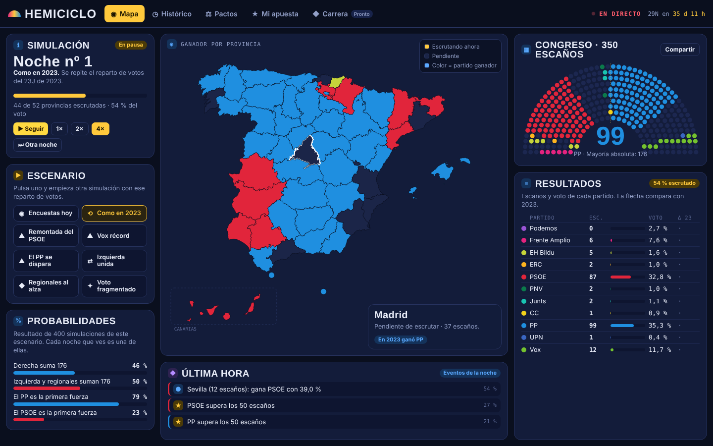
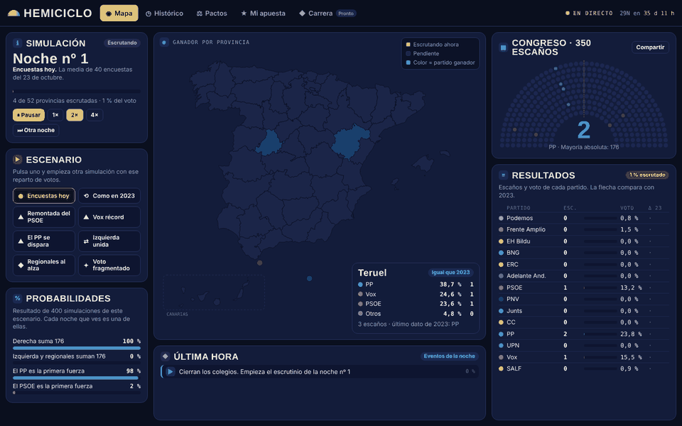
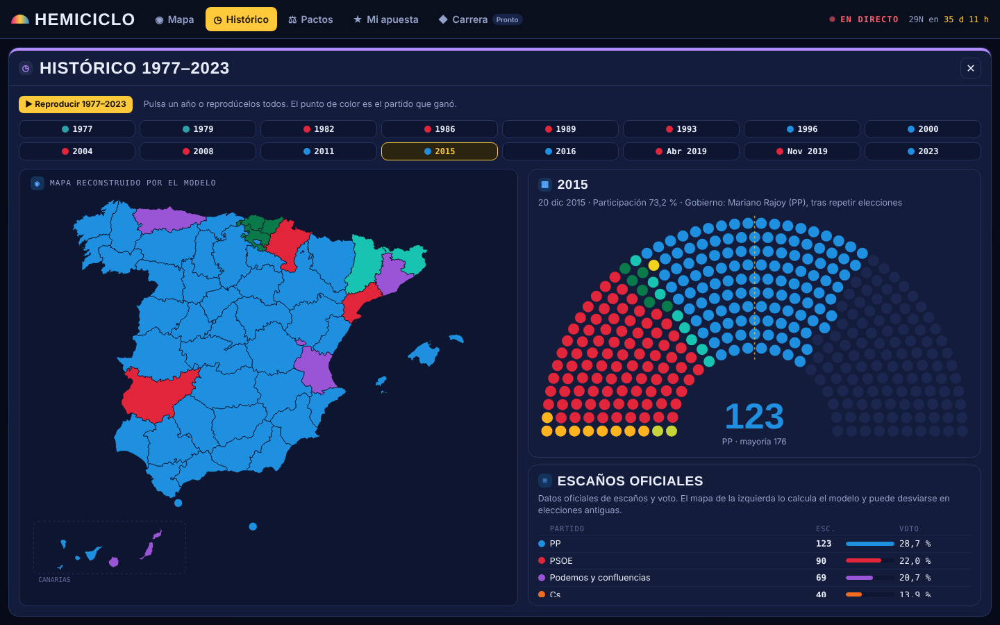
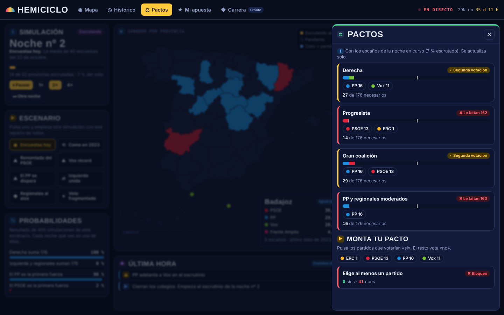
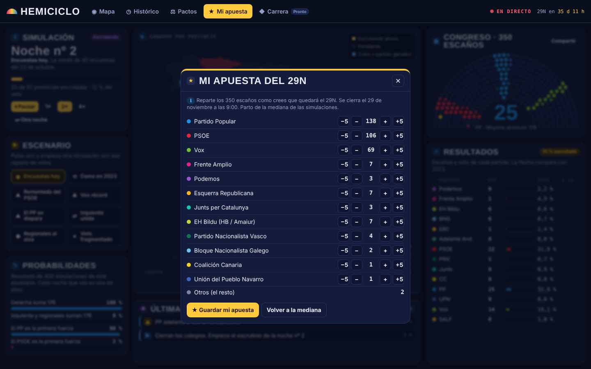
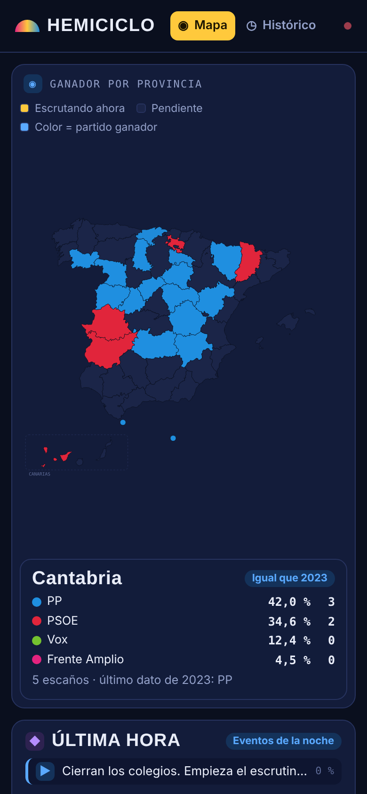

<div align="center">

# HEMICICLO

**Las elecciones generales del 29N, en directo y en un solo mapa.**
Escrutinio animado provincia a provincia, hemiciclo de 350 escaños que se llena en tiempo real y todas las coaliciones posibles.




</div>

## Qué hace

Abres la web y empieza una noche electoral simulada. Los colegios cierran, las provincias se escrutan de las pequeñas a las grandes y el Congreso se va llenando a la vista, con porcentajes, vuelcos y adelantos al segundo. Cuando termina, arranca otra noche distinta.

<div align="center">

</div>

| | |
|---|---|
| **Mapa real** | Las 52 circunscripciones con su forma real, Canarias en recuadro y Ceuta y Melilla. Pulsa una provincia y ves su resultado y si cambió respecto a 2023 |
| **Directo** | Hemiciclo de 350 puntos, números que suben animados y una columna de última hora con vuelcos, adelantos y escaños clave (50, 100 y 176) |
| **Escenarios** | Encuestas de hoy, repetir 2023, remontada del PSOE, Vox récord, el PP se dispara, izquierda unida, regionales al alza y voto fragmentado. Cada uno trae sus probabilidades calculadas con 400 simulaciones |
| **Pactos** | Coaliciones en vivo con los escaños de la noche en curso, y un montador para probar tu propio pacto de investidura |
| **Histórico** | De 1977 a 2023, en pantalla completa, con reproducción automática de todas las elecciones |
| **Mi apuesta** | Reparte los 350 escaños antes del 29N. Se puntúa con el resultado real |
| **Compartir** | Imagen de la noche en curso y enlace que reproduce exactamente la misma simulación |

## Capturas

<div align="center">
 
<br>
 
</div>

## Cómo se lee la pantalla

Cada color y símbolo tiene una función fija:

| Símbolo | Significa |
|---|---|
| ℹ azul | Información: contexto de lo que estás viendo |
| ▶ ámbar | Acción: algo que puedes pulsar |
| ✔ verde | Resultado favorable o mayoría alcanzada |
| ✖ rojo | Resultado desfavorable o bloqueo |
| ◆ violeta | Evento de la noche |
| ● rojo parpadeante | En directo |

## Veda de sondeos

La ley prohíbe publicar sondeos en los cinco días previos a la votación (art. 69.7 de la LOREG). Del 24 de noviembre a las 00:00 al 29 de noviembre a las 20:00 la web oculta las encuestas y parte del resultado de 2023. Para probarlo antes de esa fecha, añade `?veda=1` a la dirección.

## Estructura

| Ruta | Qué es |
|---|---|
| `index.html` | Resultado compilado, un solo archivo. Es lo que se publica |
| `src/engine.js` | Motor electoral: datos, D'Hondt, Monte Carlo, investidura |
| `src/core.js` | Veda, escenarios, noche en directo y coaliciones |
| `src/ui.js` | Interfaz: mapa, hemiciclo animado y ventanas |
| `src/app.css` | Estilos |
| `src/geo/` | Mapa de provincias (es-atlas, licencia MIT) y su generador |
| `tests/` | Pruebas con jsdom y capturas con Playwright |
| `legacy/` | Hemiciclo v2 y la Carrera P1, base del juego |
| `docs/` | Documentos de diseño e imágenes |

## Desarrollo

```bash
python build.py     # compila src/ en index.html
npm install
npm test            # pruebas
npm run shots       # capturas a 1440 y 390 px, con comprobación de desbordamientos
```

`index.html` se genera siempre desde `src/`; no se edita a mano.

## Próximamente

**Carrera política**, una opción pequeña dentro de la web: empiezas de militante en una provincia real y quieres llegar al Congreso. Seis medidores en forma de hexágono (Lealtad, Convicción, Base, Fama, Dinero y Energía) condicionan cada decisión. Partidos ficticios, geografía real.

---

<div align="center">Hecho por <a href="https://github.com/Ivanchux">Ivanchux</a></div>
